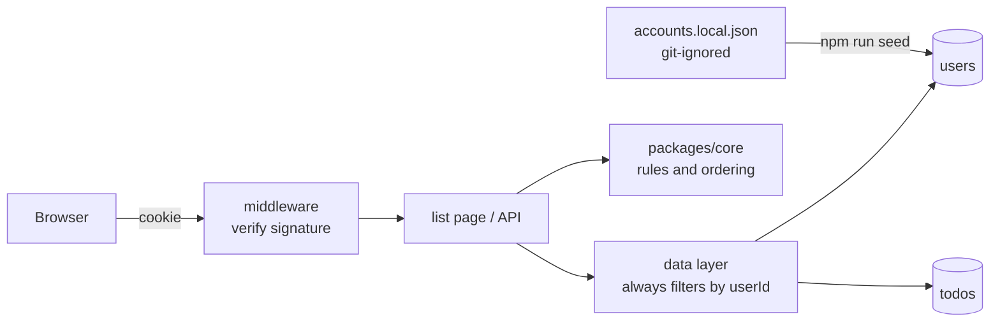

Story: #2

# Plan: Add, complete and delete to-do items

## 1. Context

The repository is a bare template. There is no `package.json`, no app, no database and no tests yet; `apps/`, `db/`, `e2e/` and `packages/core/` hold only `.gitkeep`. The stack is fixed by `docs/constitution.md`: Next.js (App Router) and TypeScript, Postgres through Drizzle ORM, Vitest, Playwright, npm; hosting on Vercel with Neon. CI (`.github/workflows/ci.yml`) already runs `lint`, `typecheck`, `test` and, if an `e2e` script exists, Playwright, once a `package.json` exists. It has no Postgres service.

So this story also builds the walking skeleton. Everything below is new.

Owner decisions that shape the design:

- Sign-in accounts come from a local seed file that is never pushed to git (PR #14, spec US6 and AC6.5/AC6.6).
- Anything under an `auth/` directory needs owner review (CODEOWNERS).
- Spec open questions 3 to 11 are decided by their recommended defaults unless the owner says otherwise at G2: title limit 140, open newest first, completed most recently completed first, audit trail out of scope, 1 s p95 target, duplicates allowed, wireframe wording for save failures, seed accounts hold a display name only, and the end-to-end server seeds the example accounts at start-up.
- Owner decision at G2 review: tests and CI use an in-memory Postgres (PGlite), not a Postgres container, so `ci.yml` is not edited.

## 2. Options

| Decision | Options | Chosen and why |
| --- | --- | --- |
| Where the account data lives at runtime | (a) read the seed file on every request; (b) a seed command copies the file into a `users` table; the app only reads the table | **(b).** Items need a foreign key to a user, and Vercel has no local file anyway. The file stays a local-only input to `npm run seed`. See ADR 0004 |
| Session | (a) signed, stateless cookie holding the user id; (b) sessions table with random tokens | **(a).** No extra table, works in edge middleware through Web Crypto, no new dependency. Ceiling: sign-out only clears the cookie, a stolen cookie can't be revoked until it expires. Acceptable for a dev-only sign-in. See ADR 0002 |
| API shape | (a) Next.js route handlers (`/api/todos`); (b) server actions | **(a).** AC5.3 and AC5.4 are HTTP-level checks, so a plain JSON API is directly testable and the UI is a thin client over it |
| Production database driver | (a) Neon serverless driver (HTTP, edge runtime); (b) `pg` on the Node runtime against Neon's pooled connection string | **(b).** Route handlers don't need the edge runtime. Only the middleware runs at the edge, and it only checks the cookie (Web Crypto) |
| Test database | (a) a Postgres service container in `ci.yml` (owner edit); (b) in-memory PGlite (real Postgres compiled to WASM) | **(b), the owner's choice.** No workflow edit, no Docker, zero setup locally. Costs one dev dependency and a second driver path: `db/client.ts` uses PGlite when `DB_DRIVER=pglite`, otherwise `pg`. The queries are identical, only the connection differs. CI never exercises the `pg` path, so one real-Postgres smoke test runs locally against `DATABASE_URL` (see Risks) |
| Completed state | (a) boolean `done`; (b) nullable `completed_at` timestamp | **(b).** One column gives both the state and the "most recently completed first" order |
| Where it deploys | (a) Vercel only; (b) Vercel plus a container build (`output: 'standalone'`, Dockerfile); (c) a lighter framework | **(b), the owner's choice.** Any container host runs it with two environment variables (`DATABASE_URL`, `SESSION_SECRET`), and Vercel is unchanged. (c) is lighter but needs a constitution change. See ADR 0001 |
| Seed command runner | (a) `tsx`; (b) Node's built-in `--experimental-strip-types` | **(b).** One dependency fewer. The seed code uses `.ts` import extensions and plain syntax |
| Sharing code between the app and tests | (a) npm workspaces; (b) one root package with a TypeScript path alias for `packages/core` | **(b).** Fewer moving parts. Revisit if a second app appears |

## 3. Design

### Components

- `packages/core/src`: pure functions with no I/O. `validateTitle` (trim, non-empty, at most 140), `groupAndOrder` (open then completed, with the orderings from the spec), `canAccess(owner, requester)` (the ownership rule) and `formatIst` (en-IN, IST).
- `db/schema.ts`, `db/migrations/**`: Drizzle schema and generated SQL.
- `apps/web/src/data`: the only code that queries items. Every function takes `userId` as a required argument and puts `user_id = $userId` in every `WHERE`. A foreign item's id therefore returns no row, never the item.
- `apps/web/src/auth` and `apps/web/src/app/auth`: session signing and verification, the sign-in page and the session route handlers. This is the whole always-human surface.
- `apps/web/src/middleware.ts`: redirects requests with no valid session to sign-in.
- `apps/web/src/app/api/todos`: item route handlers.
- `apps/web/src/app/page.tsx` and `apps/web/src/components`: the list screen, add form, rows and delete dialog, built from wireframes sign-in B, list A and confirm A.
- `db/seed.ts` and `accounts.example.json`: the seed command and the committed example. The real file, `accounts.local.json`, is git-ignored.

### Data flow

### Contracts

| Route | Request | Success | Errors |
| --- | --- | --- | --- |
| `POST /api/session` | `{ "userId": "<uuid>" }` | 204 and signed cookie | 401 if the user doesn't exist |
| `DELETE /api/session` | none | 204, cookie cleared | none |
| `POST /api/todos` | `{ "title": "..." }` | 201 and the item | 400 `{ "error": "title_required" }` or `title_too_long` |
| `PATCH /api/todos/:id` | `{ "completed": true or false }` | 200 and the item | 404 if the item isn't the caller's (also when it doesn't exist) |
| `DELETE /api/todos/:id` | none | 204 | 404 as above |

Every `/api/todos` route returns 401 without a valid session. The list page reads through the data layer directly (server component), so there is no `GET /api/todos` yet.

### Session cookie

`HttpOnly`, `SameSite=Lax`, `Secure` in production, value `<userId>.<expiry>.<HMAC-SHA-256 signature>` signed with `SESSION_SECRET` (an environment variable; never in the repo, never logged). Lifetime 7 days (an assumption; the spec doesn't say). Mutating routes also reject requests whose `Origin` header doesn't match the host (CSRF defence in addition to `SameSite`).

### Security headers and packaging

`next.config.mjs` adds a Content-Security-Policy, `X-Content-Type-Options`, `Referrer-Policy`, `X-Frame-Options` and `Permissions-Policy` to every response, and sets `output: 'standalone'`. A `Dockerfile` and `.dockerignore` build a small runtime image. Ceiling: the CSP still allows inline scripts and styles; a nonce-based policy needs the middleware (an always-human path) and is a follow-up. React already escapes titles (AC1.5), so the headers are defence in depth.

### Error handling and logging

Route handlers catch everything, return a short JSON error and log only the route name and error class: no cookie, token, title or user id values. A failed save shows "Couldn't save that change. Your list is unchanged." and the row keeps its previous state (optimistic update is rolled back). Delete failure keeps the row.

### Accessibility and UI

Follows the chosen wireframes: the checkbox and title share one `<label>` (at least 44 by 44 px), Delete is a quiet underlined button named "Delete <title>", the confirm is a native `<dialog>` opened with `showModal()` and focus starts on Cancel, errors use `role="alert"` and `aria-describedby`. The green accent is left to hi-fi (waived by the owner); the build uses neutral greys and the browser's default checkbox colour until then.

## 4. Data-model changes

New tables, one migration (always-human path `db/migrations/**`):

- `users`: `id uuid primary key default gen_random_uuid()`, `name text not null unique`.
- `todos`: `id uuid primary key default gen_random_uuid()`, `user_id uuid not null references users(id) on delete cascade`, `title text not null check (char_length(title) between 1 and 140)`, `completed_at timestamptz null`, `created_at timestamptz not null default now()`.
- Index `todos_user_idx` on `(user_id, completed_at, created_at desc)`.

Data-model change: **yes** (two new tables). Timestamps are stored in UTC and formatted to IST only when displayed.

## 5. Test strategy

Property tests use fast-check inside Vitest. "API" means Vitest against the route handlers with an in-memory PGlite database. "e2e" means Playwright against the running app, which Playwright starts with `DB_DRIVER=pglite`; the server creates the database, applies the migration and seeds `accounts.example.json` at start-up (`apps/web/src/instrumentation.ts`), so the tests only use the browser.

| AC | Task | Test that proves it |
| --- | --- | --- |
| AC1.1 | T7 | e2e: add "Buy milk", it appears in open items, field cleared |
| AC1.2 | T2, T7 | unit `validateTitle` for empty and whitespace; e2e shows "Title is required", focus stays |
| AC1.3 | T2 | unit: surrounding spaces trimmed |
| AC1.4 | T2, T6, T7 | unit at the limit and one over; API 400 `title_too_long`; e2e message names the limit |
| AC1.5 | T7 | e2e: `<b>x</b>` renders as literal text |
| AC1.6 | T7 | e2e: empty-state copy and add field |
| AC1.7 | T2, T7 | unit `formatIst` with fixed timestamps across the UTC/IST midnight boundary; e2e shows the formatted time |
| AC1.8 | T7 | e2e: Enter submits |
| AC2.1 | T7 | e2e: click the title and press Space; item moves under Completed, struck through |
| AC2.2 | T7 | e2e: untick returns it to open |
| AC2.3 | T6, T7 | API PATCH persists; e2e reload keeps it completed |
| AC2.4 | T7 | e2e with the PATCH route forced to fail: error with retry, previous state kept |
| AC2.5 | T7 | e2e: bounding box of checkbox plus title is at least 44 by 44 at 390 px |
| AC3.1 | T8 | e2e: dialog names the item with Cancel and Delete |
| AC3.2 | T6, T8 | API DELETE removes the row; e2e item stays gone after reload |
| AC3.3 | T8 | e2e: Cancel and Esc leave the list unchanged, focus returns to that row's Delete |
| AC3.4 | T8 | e2e: focus starts on Cancel, Tab cycles inside the dialog |
| AC3.5 | T8 | e2e with DELETE forced to fail: error shown, item remains |
| AC4.1 | T2, T7 | property: for any mix of items, all open precede all completed; e2e shows the two labelled groups |
| AC4.2 | T2 | property: open sorted newest first, completed by most recent `completed_at` |
| AC4.3 | T7 | e2e: strikethrough plus "Completed" label; computed contrast of at least 4.5:1 |
| AC5.1 | T9 | e2e: add items, sign out, sign in again in a fresh browser context, same items |
| AC5.2 | T2, T4, T9 | property over generated users and items (data layer returns only the caller's rows); e2e with Asha and Ben |
| AC5.3 | T2, T6 | unit `canAccess`; API: A calls PATCH and DELETE on B's id, gets 404, B's row unchanged, body has no item data |
| AC5.4 | T5, T6 | API and e2e: no cookie gives redirect (page) or 401 (API) with no item data |
| AC5.5 | T5, T6 | unit: forced errors in the handlers write log lines with no cookie or secret values |
| AC6.1 | T5 | e2e: seeded from the example file, the sign-in screen lists exactly Asha and Ben |
| AC6.2 | T5 | e2e: pick an account, land on the list showing "Signed in as <name>" |
| AC6.3 | T5 | e2e: Sign out ends the session; the list redirects to sign-in |
| AC6.4 | T5 | e2e: a forced failed sign-in shows the message and stays on sign-in |
| AC6.5 | T5 | e2e: empty `users` table shows "No accounts set up…" with no buttons |
| AC6.6 | T1, T4 | script test: `git check-ignore accounts.local.json` succeeds and `accounts.example.json` is tracked with made-up names only |
| AC7.1 | T9 | e2e at 390 and 1280 px: no horizontal scroll |
| AC7.2 | T9 | e2e: keyboard-only run through sign-in, add, complete, un-complete and delete; tab order as specified |
| AC7.3 | T7 | e2e: each Delete button's accessible name includes the title |

## 6. Always-human paths touched

- `**/auth/**`: T5 (`apps/web/src/auth/**`, `apps/web/src/app/auth/**`).
- `db/migrations/**`: T3.
- None of the others, and `.github/workflows/**` is not touched (CI already runs lint, typecheck, tests and Playwright once a `package.json` exists) (`.claude/**`, `.mcp.json`, `infra/**`, `scripts/deploy.sh`).

## 7. Rollout and rollback

- Rollout order: apply the migration to the Postgres host (Neon or any other; `npm run db:migrate`, run by the owner), run `npm run seed` locally against that database with the real `accounts.local.json`, set `DATABASE_URL` and `SESSION_SECRET` on the host (Vercel, or a container host running the Docker image), then deploy. Deploy itself stays with the owner (`scripts/deploy.sh`).
- No feature flag: the app has no existing users or data.
- Rollback: redeploy the previous build. The migration only adds tables, so the old build is unaffected. To undo the data change, drop `todos` then `users` (documented in the migration PR; Drizzle generates no down migration). Deleting item data is irreversible.

## 8. Risks

- **Greenfield size:** T1 sets up the whole toolchain, and the first build PR adds many dependencies (ADR 0001), which stops for owner approval.
- **Cross-user leaks:** mitigated by making `userId` a required parameter of every data function, the 404-for-foreign-id rule, and AC5.2/AC5.3 as tests.
- **Stateless sessions:** no server-side revoke. Mitigated by a short 7-day lifetime and dev-only use (spec Q2).
- **The `pg` path isn't tested in CI:** CI uses PGlite, so a mistake in the `pg` connection setup (pooling, SSL, the Neon connection string) would only show up in production. Mitigation: one smoke test that runs the data layer against a real Postgres when `DATABASE_URL` is set, run locally before the first deploy.
- **Docker image not built in CI:** a broken Dockerfile would only show at deploy. Mitigation: build and run it locally in T1 before merge.
- **CSP allows inline scripts:** weaker than a nonce-based policy (see ADR 0001); follow-up needs an owner-reviewed middleware change.
- **PGlite differences:** a WASM single-user build that can lag behind the Postgres version on Neon. The schema uses only core features (uuid default, check constraint, foreign key, `timestamptz`, a composite index), so the risk is low.
- **Seed file handling:** accidental commit. Mitigated by the ignore rule, the AC6.6 test and secret-scan review.
- **Edge profile vs Node driver:** if the owner later moves routes to the edge runtime, the `pg` driver must be swapped for Neon's serverless driver (data layer is the only place to change).
- **Time zones:** covered by core unit tests with fixed timestamps.
